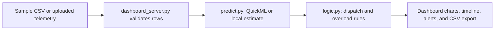

# SpringGrid

SpringGrid is a microgrid forecasting dashboard for exploring hourly community demand and the source recommendation for each forecast hour. It combines a Python forecasting endpoint, the HackSphere transition rules, and an interactive dashboard for inspecting the results.

> **Current scope:** this project runs locally with the included Python server. A Zoho Catalyst deployment, live sensor connection, and physical grid or battery controls are not included in the current code.

## What it does

- Produces up to 24 hourly demand predictions from weather telemetry.
- Recommends **Renewable Storage Mode** when predicted demand is above 160 kW or the timestamp is between 18:00 and 22:00 inclusive; otherwise it recommends **Main Grid Mode**.
- Flags a critical overload when predicted demand is at least 200 kW. This alert rule applies independently of the selected source mode.
- Shows the forecast in an interactive dashboard with a demand and weather explorer, dispatch recommendations, an hourly timeline, and grid watch alerts.
- Lets you select forecast hours, replay the timeline, inspect dispatch nodes, and run a clearly marked what-if load stress scenario.
- Accepts weather telemetry as a CSV and exports forecast and scenario values as a CSV.

The routing graphic visualizes model recommendations; it does not show measured power flow, solar generation, or battery state of charge. The stress control changes forecast values for a what-if scenario and does not change the source input.

## Project files

| File | Purpose |
| --- | --- |
| `dashboard_server.py` | Serves the dashboard, validates input, exposes the forecast API, and joins the prediction and dispatch steps. |
| `index.html` | Dashboard interface, charts, forecast timeline, dispatch map, telemetry upload, and CSV export. |
| `predict.py` | Calls a configured QuickML prediction endpoint or returns the local starter estimate. |
| `logic.py` | Applies the HackSphere source-selection and overload-alert rules. |
| `train_telemetry.csv` | Historical telemetry with `target_demand_kw`, intended for model training. |
| `sample_test_input.csv` | Example weather input without the demand target; used by the dashboard's sample forecast. |
| `test_eval.py` | HackSphere pre-submission contract checker for `predict.py`. |
| `PROBLEM_STATEMENT.md` | HackSphere 3.0 challenge brief and evaluation requirements. |

## Requirements

- Python 3
- `numpy`, `pandas`, and `requests`
- A modern browser

The dashboard loads Chart.js and its fonts from public CDNs, so an internet connection is needed for those external assets. The backend can still return forecasts using the local estimate when QuickML is not configured or unavailable.

## Run locally

From the project directory, create and activate a virtual environment, then install the Python packages:

```bash
python3 -m venv .venv
source .venv/bin/activate
python -m pip install numpy pandas requests
```

Start the dashboard server:

```bash
python3 dashboard_server.py
```

Open [http://127.0.0.1:8000](http://127.0.0.1:8000). Select **Run forecast** to use the first 24 rows of `sample_test_input.csv`. Keep the terminal running while using the dashboard; press `Ctrl+C` there to stop the server.

## Use your own telemetry

Upload a CSV from **Telemetry** or put rows in the forecast API request. Each row must contain these columns:

| Column | Meaning | Example |
| --- | --- | --- |
| `timestamp` | Hour of the forecast in a parseable date-time format | `2024-01-01 15:00:00` |
| `ambient_temp_c` | Ambient temperature in °C | `28.5` |
| `humidity_pct` | Relative humidity in percent | `62.0` |
| `solar_irradiance_wm2` | Solar irradiance in W/m² | `310.0` |

`target_demand_kw` belongs in the training dataset; it is not required in forecast input. The server validates timestamps and numeric weather values, then uses at most the first 24 rows. It rejects API request bodies larger than 2 MB; browser uploads send only the first 24 parsed rows for forecasting.

## Forecast API

The local server exposes two endpoints:

- `GET /api/health` — reports that the local SpringGrid Python pipeline is available.
- `POST /api/forecast` — returns predictions and dispatch signals. Send `{"rows": [...]}` with telemetry rows and optionally a `filename`. If `rows` is omitted, the server forecasts the bundled sample input.

Example request body:

```json
{
  "filename": "weather.csv",
  "rows": [
    {
      "timestamp": "2024-01-01 15:00:00",
      "ambient_temp_c": 28.5,
      "humidity_pct": 62.0,
      "solar_irradiance_wm2": 310.0
    }
  ]
}
```

Each returned forecast row includes its timestamp, predicted demand, grid mode, overload alert, and original weather features.

## QuickML configuration

`predict.py` contains the `QUICKML_ENDPOINT_URL` constant. In the current starter setup, it matches the bundled placeholder URL, so the prediction function uses a local estimate: a daily demand curve adjusted for warmer temperatures. To use a published QuickML model, replace that constant with your team’s endpoint URL.

The current code does not read environment variables or add authentication headers. If your endpoint requires credentials, implement secret handling through environment variables or your deployment platform’s secret manager before using it; do not commit credentials to the repository. `dashboard_server.py` labels a successful configured endpoint as **QuickML prediction** and a failed call as **Local estimate · QuickML unavailable**.

## How the pieces fit together



`train_telemetry.csv` is available for training a regression model. `sample_test_input.csv` supplies weather features only, so the app can demonstrate inference without using the target column.

## Optional contract check

Run the supplied evaluator from the project directory to check that `predict.py` returns one finite prediction per sample row:

```bash
python test_eval.py
```

This check validates the prediction function contract; it does not verify a QuickML deployment or the dashboard UI.

## Hackathon deployment

The challenge brief describes a Zoho Catalyst architecture and asks teams to submit a public app URL and project code. This repository currently contains a local Python server and frontend, but no Catalyst deployment configuration. Deployment and any platform-specific secrets need to be configured separately before sharing a public app URL.
